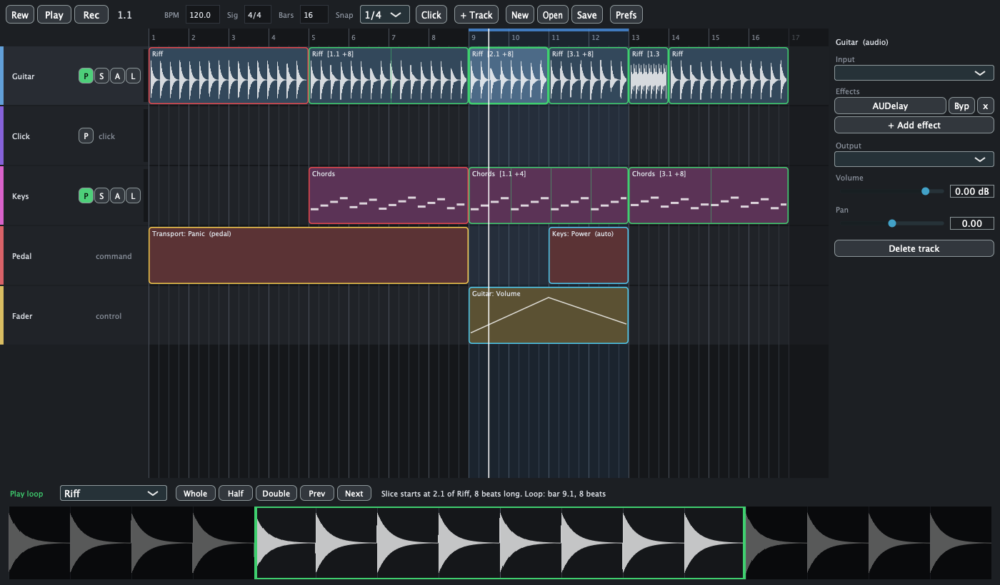

# Looper

**An arranged live looper for macOS. Script your loops on a timeline, press Record, and perform hands-free.**



Most loopers make you stomp a pedal at exactly the right moment, for every layer, every time. Looper turns that around: you draw the song first, then you just play it.

- A **record region** (red) says "capture what I play here".
- A **play region** (green) says "loop that recording here".

Press Record and the playhead walks the timeline. You hear yourself inside the record regions, and everything you played comes back exactly where you scripted it. Your hands stay on the instrument.

## What it does

- **Slice playback.** A play region can loop any part of a recording, in any subdivision. Record four bars once, then loop bars 1 to 2 in the verse, bars 3 to 4 in the chorus, and a single 16th note as a stutter fill.
- **Audio and MIDI.** Audio tracks loop your input. Instrument tracks loop the notes and replay them through a plugin.
- **Recorded dry, played through the effects.** Change a track's plugins and every loop on it follows.
- **Plugin host.** VST3 and Audio Unit instruments and effects, one chain per track.
- **Any output.** Every track picks its own input and output pair, including the click track and talkback, so the band hears the click and the audience does not.
- **Takes, reference takes and Panic.** The last 8 takes of every recording are kept. Mark a good one as the reference, and one pedal press swaps it in when you fluff a part live.
- **Automation tracks.** Command tracks put transport, mutes and effect switches on a pedal, or fire them by themselves at a bar. Control tracks draw curves or route a fader to any plugin parameter.
- **Play it from the laptop.** With no MIDI keyboard connected, the computer keyboard plays the selected instrument, and drum tracks get a full kit on the keys.
- **The recording follows the script.** While recording, whichever instrument has a record region coming up becomes the live one. No mouse.

## Status

**v0.1 is an early build.** It was written in one long session and has been used for hours, not months.

Checked so far: the loop engine (a self-check proves slices play back sample-exact), drawing and moving regions, MIDI recording and looping through Apple's built-in synth, saving and loading songs.

Not yet proven on a stage: audio input with a real instrument and interface, latency compensation by ear, third-party plugins, hardware pedals and faders. Expect rough edges and please report them.

Apple Silicon only for now.

## Install

1. Download `Looper-0.1.0-macOS-arm64.zip` from [Releases](../../releases) and move `Looper.app` to Applications.
2. The app is not notarized, so macOS blocks the first launch. Run this once:

```bash
xattr -dr com.apple.quarantine /Applications/Looper.app
```

3. Allow the microphone when asked. Without it, audio tracks record silence.

## Quick start

1. **Right-click a track** and choose "Record region here". Drag its right edge to make it four bars.
2. **Right-click after it** and choose "Play region here". Stretch it as long as you like.
3. Press **Return** to record and play your part. It loops by itself.
4. Select the play region. The strip at the bottom shows the recording with a green window on it. **Drag the window** to choose which slice loops.

| Key | Action |
|---|---|
| Space | Play or stop |
| Return | Record or stop |
| R | Rewind |
| Q | Loop the selected region |
| L | Lock the track (rehearse without overwriting) |
| P | Panic |
| Z, Shift-Z | Undo, redo |
| Backspace | Delete the selection |

Drag on empty space to select several regions, drag a selection to move it, Alt-drag to copy it. Double-click a recording to name it.

**Instrument tracks:** A S D F G H J K play one octave from middle C, with W E T Y U for the black keys.

**Drum tracks:**

| Key | Drum | Key | Drum |
|---|---|---|---|
| ` | Crash left | Q | Closed hat |
| 1 | Crash right | W | Pedal hat |
| 2 | Ride | E | Open hat |
| 3 | China | A | High tom |
| Z | Kick | S | Mid tom |
| X | Snare | D | Low tom |

Songs are folders named `Something.looper` in `~/Music/Looper/` and they autosave.

## Build from source

You need the Xcode Command Line Tools, CMake and Ninja. Full Xcode is not required.

```bash
xcode-select --install
brew install cmake ninja
git clone https://github.com/LevNyyon/looper.git && cd looper
git clone --depth 1 --branch 8.0.15 https://github.com/juce-framework/JUCE.git third_party/JUCE
cmake -S . -B build -G Ninja -DCMAKE_BUILD_TYPE=Release
cmake --build build --target Looper selfcheck
build/selfcheck
open build/Looper_artefacts/Release/Looper.app
```

## How it is built

C++17 and [JUCE](https://juce.com) 8, nothing else.

| Folder | What is in it |
|---|---|
| `engine/` | The looper core: a script of record and play regions driving loop buffers. Standard library only, no devices, no UI. `selfcheck.cpp` is its one check. |
| `app/` | The JUCE app: song model and file format, audio and MIDI host, plugin chains, timeline UI, automation. |
| `PLAN.md` | The working plan: scope, decisions, every deliberate shortcut and what was and was not verified. |

The core is small because everything is known in advance. A record region has a fixed length, so its buffer exists before you play a note, and a play region is just a read position: `sliceStart + ((playhead - regionStart) mod sliceLength)`.

Shortcuts that were taken on purpose are marked in the code with a `ponytail:` comment naming the limit and the upgrade path.

## Credits

Looper is inspired by **ALK2** by zenAud.io, a wonderful arranged looper that was discontinued in 2021. This is an independent reimplementation of the idea, written from scratch from the public manual. It contains no ALK2 code and is not affiliated with zenAud.io.

## License

[GNU AGPL v3](LICENSE), the license JUCE is free under.
